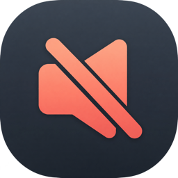

<p align="center">
  
</p>

<h1 align="center">Silentio</h1>

<p align="center">
  <b>Keep your Mac quiet when headphones disconnect or the Mac wakes from sleep.</b><br>
  A small, native macOS menu bar app that mutes the built-in speakers and pauses your music.
</p>

<p align="center">
  <a href="https://github.com/vordenken/Silentio/releases/latest"></a>
  <a href="https://github.com/vordenken/Silentio/actions/workflows/build-release.yml"></a>
  <a href="LICENSE"></a>
  
  <a href="CONTRIBUTING.md"></a>
</p>

## ✨ Features

- 🔇 **Mute on output change** — mutes the built-in speakers when audio switches to them,
  for example after unplugging headphones or disconnecting AirPods; optional delay of up to 5 seconds
- 😴 **Mute after sleep** — mutes the built-in speakers when the Mac wakes, for example after opening the lid
- ⏸️ **Pause players** — pauses Spotify, Apple Music and VLC; paused or closed players are never started
- 🔊 **Restore** — restores the previous speaker state when you reconnect your headphones,
  without changing the headphone volume
- 🔁 **Always pause players** — optionally pauses players on every output change
- 🎛️ **Menu bar control** — enable or disable Silentio with one click, with optional
  monitoring at startup and muting the speakers when monitoring is enabled
- 🚀 **Launch at login** — via macOS's built-in login items
- 🔄 **Automatic updates** — via Sparkle, with optional automatic downloads and beta versions;
  background updates get a gentle menu bar reminder
- 💻 **Universal** — runs natively on Apple Silicon and Intel Macs, no Rosetta needed
- 🔒 **Private** — sandboxed, no accounts, no analytics, no audio recording

## 🚀 Quick Start

1. Download `Silentio.dmg` from the [latest release](https://github.com/vordenken/Silentio/releases/latest)
2. Open the disk image and drag **Silentio.app** to your Applications folder
3. Open Silentio and follow the short welcome — afterwards it lives in your **menu bar** (no Dock icon)
4. To pause players, allow Silentio under **System Settings → Privacy & Security → Automation**
   when macOS asks

> [!WARNING]
> Silentio is not notarized by Apple, so macOS may block both the disk image and the app.
> To open it anyway:
>
> 1. Try to open the disk image or Silentio once and close the warning
> 2. Open **System Settings → Privacy & Security**
> 3. Scroll down and click **Open Anyway** next to the Silentio message
> 4. Confirm with your password or Touch ID
> 5. Repeat for the app after copying it to Applications if macOS blocks it again
>
> Please do not disable Gatekeeper globally.

### Good to know

- Silentio only reacts to the built-in speakers. Headphones, AirPods, USB and HDMI outputs are never muted.
- On Macs with a shared headphone jack, plugging in headphones does not change the headphone
  volume or mute state; the previous speaker state is kept until it can be restored safely.
- Players are paused only if they are running and enabled in the settings. Silentio never launches a player.
- Click the menu bar icon to open the settings, check for updates or enable and disable Silentio.

## 💻 Requirements

- macOS 13 (Ventura) or later
- Apple Silicon or Intel Mac

## 🔨 Building & Releasing

Open `Silentio.xcodeproj` in Xcode, select the **Silentio** scheme and press **Run** (⌘R).
For a universal release build:

```bash
bash scripts/build.sh
open dist/Silentio.app
```

See [BUILD.md](BUILD.md) for build requirements, tests and the release process.

## ⚙️ How It Works

Silentio listens to CoreAudio for changes of the default output device and its active
data source. When the output switches to the built-in speakers, or the Mac wakes from
sleep, it mutes them (or sets their volume to zero if the device cannot be muted) and
remembers their previous state. When the output switches to another device, it restores
that state, so the speakers are not left muted. Players are paused through Apple Events with player-specific commands, so
a paused VLC is not accidentally resumed.

## 🤝 Contributing

Contributions are welcome! Please read the [contributing guidelines](CONTRIBUTING.md)
and check the [security policy](SECURITY.md) before reporting vulnerabilities.

## ❤️ Support

If you find Silentio useful, consider supporting its development:

<a href="https://www.buymeacoffee.com/vordenken"></a>
<a href="https://ko-fi.com/vordenken"></a>

## 📝 License & Privacy

Silentio is licensed under the [GNU General Public License v3.0](LICENSE).
Copyright © 2026 vordenken.

Silentio collects no data; its only network access is the update check via Sparkle. See the [privacy policy](PRIVACY.md).

## 🙏 Acknowledgments

Inspired by [Relax – Unplug](https://apps.apple.com/app/relax-unplug/id1440712920), which has not
been updated in a long time and, as Intel code, will no longer be supported from macOS 28.
Silentio is an independent, open-source replacement and is not affiliated with the original
app or its developer. Updates via [Sparkle](https://sparkle-project.org).

---

<p align="center">Created by <a href="https://github.com/vordenken">vordenken</a></p>
